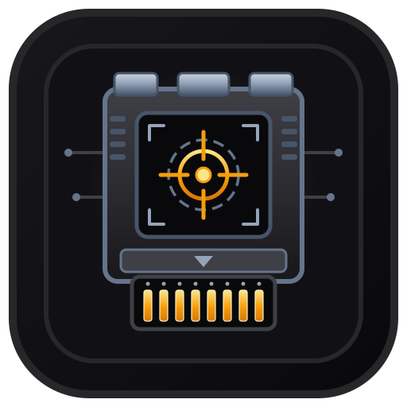

<div align="center">



# IronFrame OuterFortress (Cart) 01 Decomp

Clean-room 6502 decompilation research, binary format specifications, and portable `.decomp` recipe work for `NES-ME-USA` (`iNES Mapper 2 / UNROM`).

 [](https://github.com/StreamResearch/IronFrame-OuterFortress-Cart-01-Decomp/actions/workflows/ci.yml) [](https://streamresearch.github.io/IronFrame-OuterFortress-Cart-01-Decomp/)   -lightgrey?style=flat)

**Beta (Pre-1.0, `D4/S4/R0`):** Active clean-room research repository (`v0.3.0`) delivering `26` warning-free, zero-tell idiomatic C11 modules (`507` symbols across `34` C/header files, `0` decompiler tells, `36` files in `Corpus/readable/`, `10/10` `D4a` subsystem parity assertions under `-Wall -Wextra -Wno-unused-parameter`), preserved raw/sliced/mapped/clean-source tier snapshots, `5` zero-body rewrite shards, a verified `1:1` 6502 assembler, a self-contained BYO-ROM unpacker, a `47`-entry `.decomp` bundle (`IronFrame-OuterFortress-Cart-01.decomp`) targeting `reCart` (`0.1.x`), `20` offline unit tests, and technical manuals—advancing toward multi-frame execution lockstep in `v0.4.0`.

**6502 Assembly 1:1 ROM Match:** `8 / 8` PRG banks (`131,088 / 131,088` bytes, `0` mismatched bytes, `CRC32=25BA3D04`) · **Clean Idiomatic C11 (`D4/S4/R0`, `D4a` Subsystem Parity):** `26 / 26` domain modules (`507` symbols across `34` C/header files, `0` decompiler tells, `0` warnings under `-Wall -Wextra -Wno-unused-parameter`, `10/10` host assertions) · **Execution Lockstep:** `0` verified frame traces (scheduled for `v0.4.0`)

</div>

- [x] **6502 Assembly Byte-Exact Reassembly & Symbol Catalog** — Clean-room two-pass 6502 assembler matching all 8 PRG banks (`131,088` bytes) alongside `499 / 499` indexed functions, `2,324 / 2,324` mapped globals, `22` structs, and `22` enums.
- [x] **Portable `.decomp` Bundle, Offline Tests & Clean-Room Tooling (`v0.1.0`)** — Self-contained BYO-ROM unpacker (`nes_unrom_unpack.py`), `reCart` (`0.1.x`) validated `IronFrame-OuterFortress-Cart-01.decomp`, modular `d4_harness/` C parity runner, offline `unittest` suite, and static documentation site.
- [x] **Cohesive Domain C Modules, Resolved Symbols & Multi-Tier Snapshots (`v0.2.0`)** — Replaced all `68` line-split fragments with `26` cohesive domain C modules (`10` fixed-bank core + `16` switchable-bank overlay modules), resolved all `299` raw symbol aliases and `44` raw cross-bank declarations (`0` remaining raw tokens), synthesized `8` bank/signature adapters, preserved raw/sliced/mapped local tier snapshots, and verified `18/18` offline `unittest` cases, `14/14` integrity checks, `10/10` host parity checks, `8/8` ROM banks (`CRC32=25BA3D04`), and the strict clean-room `v0.2.0` `.decomp` bundle.
- [x] **Clean Idiomatic C & Zero-Warning Parity (`v0.3.0`)** — AST-normalized all `26` C modules and `8` headers (`34` C/header files, `507` symbols, `0` decompiler tells), removed `.clangd` diagnostic suppressions, compiled `26/26` modules with `0` errors and `0` warnings under `-Wall -Wextra -Wno-unused-parameter`, verified `10/10` `D4a` host subsystem parity assertions, `20/20` offline `unittest` cases, `15/15` `verify_track_d5.py` checks (`9/9` synthetic), `8/8` ROM banks (`CRC32=25BA3D04`), `36` files in `Corpus/readable/`, `5` zero-body rewrite shards, and the strict `47`-entry `v0.3.0` `.decomp` bundle.
- [ ] **Execution Lockstep, Bank Decoders & Archival Gold (`v0.4.0`–`v1.0.0`)** — Frame-by-frame RAM/PPU/APU lockstep verification (`D4b`), Bank `1..4` and audio table decoders, complete format specs, and certified archival reference status.

---

## About

This repository documents the binary layout, hardware interfaces, and bank-switched program structure of North American `NES-ME-USA` using strictly clean-room reverse engineering. It pairs typed C headers, JSON module maps, symbol overrides, zero-body rewrite shards, and call-graph catalogs, a clean-room two-pass MOS 6502 assembler, a BYO-ROM UNROM unpacker, deterministic cohesive C coalescing and zero-tell C11 normalization pipelines, and technical reference manuals without distributing copyrighted ROM images, game assets, or compiled binaries.

In `v0.3.0` (`D4/S4/R0`), the repository normalizes all `507` symbols (`499` mapped functions plus `8` adapters) across `26` domain C modules and `8` headers (`34` C/header files) into zero-tell, warning-free C11 (`-Wall -Wextra -Wno-unused-parameter`), verifies `10/10` `D4a` subsystem parity assertions, preserves raw, sliced, mapped, and clean-source local tier snapshots (`36` files in `Corpus/readable/`), and exports a strict clean-room `47`-entry `v0.3.0` `.decomp` recipe (`IronFrame-OuterFortress-Cart-01.decomp`) targeting `reCart` (`0.1.x`), alongside the [Documentation Site](https://streamresearch.github.io/IronFrame-OuterFortress-Cart-01-Decomp/) published from `Dev/docs/` and root documentation.

## Key Features

- **Clean Idiomatic C11 Normalizer & Rewrite Shards:** `craftsmanship_d4_helpers.py`, `craftsmanship_d4_ast_cleaner.py`, and `craftsmanship_d4_normalizer.py` eliminate all decompiler idioms across `34` C/header files and `507` symbols (`0` tells), unroll `69` comma-operator `if` conditions, emit fixed-width `s8..u64` headers and zero-suppression `.clangd`/`compile_commands.json` (`-Wall -Wextra -Wno-unused-parameter`), and export `5` zero-body JSON shards under `Dev/schemas/d4_rewrites/`.
- **Cohesive Domain C Coalescer & Multi-Tier Snapshots:** `coalesce_d4_modules.py` and `materialize_decomp_tiers.py` merge `68` legacy line-split C slices into `26` bank-aware domain C modules (`10` core + `16` overlay modules), resolve all `299` raw global aliases and `44` raw cross-bank calls with `8` synthesized bank/signature adapters, preserve `D1_Raw`, `D2_Structured`, `D3_Mapped`, and `D4_CleanSource` snapshot tiers, and sync `36` files into `Corpus/readable/`.
- **Clean-Room 6502 Assembler & BYO-ROM Unpacker:** `asm6502_d5.py` supports all `56` official MOS 6502 mnemonics and `151` opcodes (`13` addressing modes plus `a:` absolute override), paired with `nes_unrom_unpack.py` and `nes_6502_cfg.py` for SHA-256-verified `.nes` bank extraction (`8/8` banks, `CRC32=25BA3D04`) and synthetic offline verification.
- **Portable `.decomp` Bundle & Release Packager:** `export_decomp_bundle.py` and `package_release.py` produce deterministic, clean-room `v0.3.0` `IronFrame-OuterFortress-Cart-01.decomp` packages (`47` entries including `d4_build_report.json` and `5` `d4_rewrites/*.json` shards) and staged release archives validated against `reCart` (`0.1.x`) clean-room rules.
- **Modular Host C Parity & Offline Tests:** `Dev/scripts/d4_harness/` compiles cleanly without pointer-cast suppressions and runs `10/10` `D4a` subsystem parity assertions across four modular files (`parity_harness.h`, `parity_runner_main.c`, `parity_rom_and_mapper_tests.c`, `parity_gameplay_and_audio_tests.c`), backed by `20` offline `unittest` tests under `Dev/scripts/tests/` and `15/15` unified integrity checks (`verify_track_d5.py`, `9/9` offline synthetic).
- **Complete Memory, Module & Symbol Catalog:** Indexes all `499` functions across `26` modules (`8` bank domains), `2,324` mapped hardware/RAM/ROM globals (`2,344` header externs including `20` deduplicated synthetic overrides), `39` entry anchors, `22` C structs, and `22` enums (`0` unresolved fields).
- **Technical Manual Shelf:** Four linked manuals covering bank architecture, binary specifications, reverse-engineering findings, and clean-room operations.

## Getting Started

### Prerequisites

- **Python 3.12+** on your `PATH`
- *Optional:* `zig` (`0.17+`) and `clangd` if you want to compile freestanding / host C parity modules locally
- *Optional:* `7z` (`7-Zip`) when creating `.7z` release bundles with `package_release.py`

### Quick Try (No ROM Required)

Clone the repository and run the offline unit test suite or smoke-test the 6502 assembler without any cartridge media:

```powershell
git clone https://github.com/StreamResearch/IronFrame-OuterFortress-Cart-01-Decomp.git
cd IronFrame-OuterFortress-Cart-01-Decomp

# Run all 20 offline unit tests (validates unpacker, assembler, coalescer, AST normalizer, tier builder, CLI gates, and .decomp bundle)
python -B -m unittest discover -s Dev/scripts/tests -v

# Smoke-test the clean-room two-pass 6502 assembler directly
python -B -c "import sys; sys.path.insert(0, 'Dev/scripts'); import asm6502_d5; raw, org, _ = asm6502_d5.assemble_text('.org 0xC000\nLDA #0x01\nSTA 0x00\nRTS\n'); print(f'Opcodes={sum(len(v) for v in asm6502_d5.OPCODES.values())} Bytes={raw.hex()} Origin=${org:04X}')"
```

<details>
<summary>Developer verification, `--offline-synthetic` CLI flags, `.decomp` packaging, and local BYO-ROM commands</summary>

```powershell
# Offline synthetic modes (zero ROM required; optional --out-dir, --rewrites-dir, and --log-dir overrides)
python -B Dev/scripts/nes_unrom_unpack.py --offline-synthetic --out-dir Corpus/work/synth_unpacked
python -B Dev/scripts/coalesce_d4_modules.py --offline-synthetic
python -B Dev/scripts/craftsmanship_d4_normalizer.py --offline-synthetic
python -B Dev/scripts/materialize_decomp_tiers.py --offline-synthetic
python -B Dev/scripts/build_and_verify_d5.py --offline-synthetic
python -B Dev/scripts/build_and_verify_d4.py --offline-synthetic
python -B Dev/scripts/gen_d4_globals_and_lifts.py --verify-only
python -B Dev/scripts/verify_track_d5.py --offline-synthetic

# Build and strictly validate the clean-room .decomp bundle and release stage
python -B Dev/scripts/export_decomp_bundle.py --verify-cleanroom --strict
python -B Dev/scripts/package_release.py --out-dir ./release_stage --no-7z

# Full local verification with your own legally obtained NES-ME-USA ROM in Corpus/
python -B Dev/scripts/nes_unrom_unpack.py --rom path/to/NES-ME-USA.nes --out-dir Corpus/work/unpacked
python -B Dev/scripts/materialize_decomp_tiers.py
python -B Dev/scripts/build_and_verify_d5.py
python -B Dev/scripts/build_and_verify_d4.py
python -B Dev/scripts/verify_track_d5.py
```

All verification CLIs support `--data-dir`, `--out-dir`, `--log-dir`, and `--offline-synthetic`, returning exit code `2` with structured `MISSING_CORPUS_MEDIA` JSON when local ROM extracts are absent. See `Dev/schemas/decomp_local.example.json` and [Operations](Dev/docs/OPERATIONS.md) for all overrides (`--zig-exe`, `--tools-dir`, `--host-target`, `--tier`, `--rewrites-dir`).

</details>

## Project Structure

- `Dev/` — Python assemblers, UNROM unpacker, cohesive module coalescer, AST C11 normalizer, multi-tier snapshot builder, `.decomp` exporter, offline `unittest` suite, modular `d4_harness/` C parity runner, typed C headers, JSON schemas (including `d4_rewrites/*.json`), clean-room SVG/PNG/ICO emblems, and technical manuals
- `IronFrame-OuterFortress-Cart-01.decomp` — Deterministic clean-room `v0.3.0` `.decomp` recipe bundle (`47` entries) targeting `reCart` (`0.1.x`)
- `Corpus/` — Local working directory for your own verified ROM extracts, preserved `D1_Raw`–`D4_CleanSource` snapshot tiers, and `36`-file `readable/` C11 tree (gitignored; never committed)
- `Archive/` — Compressed local clean-room source snapshots

## Documentation

- [Documentation Site](https://streamresearch.github.io/IronFrame-OuterFortress-Cart-01-Decomp/) — Published GitHub Pages manuals and reference views
- [Features](FEATURES.md) — Current capabilities and module status
- [Roadmap](ROADMAP.md) — Active goals and upcoming milestones through `v1.0.0`
- [Changelog](CHANGELOG.md) — Version history
- [Contributing](CONTRIBUTING.md) — Clean-room contribution guidelines and PR checklist
- [Security Policy](SECURITY.md) — Vulnerability reporting and asset isolation rules
- [Architecture](Dev/docs/ARCHITECTURE.md) — `iNES Mapper 2 / UNROM` bank topology, `26` cohesive modules, dispatchers, and symbol layout
- [Specifications](Dev/docs/SPECIFICATIONS.md) — C11 types, 6502 memory map, cartridge header, and verification schemas
- [Findings](Dev/docs/FINDINGS.md) — Bus-conflict LUT analysis, audio sequencer recovery, symbol resolution, and 6502 assembly match
- [Operations](Dev/docs/OPERATIONS.md) — Local workspace layout, CLI overrides, tier materialization, `.decomp` packaging, and snapshot hygiene

## License & Legal

Distributed under the **MIT License** ([LICENSE](LICENSE)) for all clean-room Python tooling, JSON schemas, C headers, and documentation in this repository. See [SECURITY.md](SECURITY.md) for clean-room boundaries and private vulnerability reporting.

**No Copyrighted Assets:** This repository contains zero retail ROM images, extracted game graphics, audio data, or proprietary binaries. Any local verification against cartridge media requires a legally obtained North American `NES-ME-USA` image supplied by the user inside the gitignored `Corpus/` directory.

This independent clean-room research project is not affiliated with, endorsed by, or connected to the original cartridge hardware manufacturer, publisher, or rights holders.
