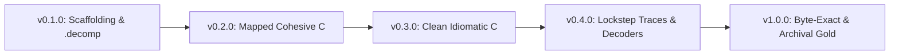

# Roadmap

Current baseline: **v0.3.0 (Beta — Clean Idiomatic C & Subsystem Parity)** | Active target: **v0.4.0** | See [CHANGELOG.md](CHANGELOG.md) for release notes.

## Vision

- **v0.4.0 (RAM-Oracle Lockstep & Format Decoders):** Clean-room NES bus runtime verifying multi-scene WRAM/OAM/PPU/APU frame lockstep (`D4b`) alongside complete clean-room decoders and specification chapters for Bank `1..4` and sound tables.
- **v1.0.0 (Byte-Exact & Archival Gold Reference):** Full clean-room BYO-ROM round-trip matching the verified `131,088`-byte `NES-ME-USA` image (`CRC32=25BA3D04`), zero unresolved format fields, live static documentation site, and `reCart`-ready `.decomp` bundle.

## Active Milestone: v0.4.0 — Frame-by-Frame Execution Lockstep & Bank Decoders

- [ ] **Multi-Scene `NesBus` Runtime & `D4b` RAM-Oracle Lockstep:** Build a clean-room NES bus runtime under `Dev/scripts/d4_harness/` to capture and verify multi-scene `$0000-$07FF` WRAM (`$0100-$01FF` hardware stack masked transparently), OAM, PPU, and APU frame traces against reference execution oracles (`mismatchedFrames == 0`), emitting `Dev/schemas/d4b_lockstep_report.json`.
- [ ] **Bank `1..4` & `BANK_06` Decoders + Spec Spokes:** Author flat `<= 250`-line clean-room decoders for room/metatile layouts, guard patrol tables, weapon stats, codec data, and `BANK_06` envelope/pattern tables alongside `Dev/docs/specifications/*.md` chapters (`0` unresolved fields).

## Upcoming Milestones

- **v1.0.0 — Byte-Exact & Archival Reference Gold:** Certify clean-room end-to-end ROM verification from a fresh clone with user-supplied media (`CRC32=25BA3D04`), finalize zero-gap format coverage (`0` unresolved fields) and technical manuals, and publish the non-prerelease Gold milestone.

## Completed Milestones

- [x] **v0.3.0 Clean Idiomatic C & Subsystem Parity (`2026-11-22`):** Normalized all `26` C modules and `8` headers (`34` C/header files, `507` symbols = `499` catalog functions + `8` adapters, `0` decompiler tells) via `craftsmanship_d4_{helpers,ast_cleaner,normalizer}.py`, unrolled `69` comma-operator `if` conditions, fixed header/override tells (`2,344` header externs), stripped `.clangd` diagnostic suppressions, compiled `26/26` modules with `0` errors and `0` warnings under `-Wall -Wextra -Wno-unused-parameter` (`10/10` `D4a` subsystem parity assertions, `8/8` ROM banks `1:1` `CRC32=25BA3D04`), preserved `D1_Raw`..`D4_CleanSource` (`36` files synced into `Corpus/readable/`), shipped `5` zero-body `Dev/schemas/d4_rewrites/*.json` shards, passed `20/20` offline `unittest` cases (`-W error`) and `15/15` `verify_track_d5.py` checks (`9/9` synthetic), and exported the strict `47`-entry `v0.3.0` `.decomp` bundle (`D4_CleanSource` / `D4a Subsystem Parity`). ([Notes](CHANGELOG.md#030---2026-11-22))
- [x] **v0.2.0 Mapped Cohesive C Modules & Multi-Tier Snapshots (`2026-11-20`):** Coalesced all `499 / 499` functions from `68` line-split fragments into `26` cohesive domain C modules (`10` core + `16` overlay modules), resolved all `299` raw symbol aliases and `44` raw cross-bank calls (`0` remaining raw tokens, `8` synthesized adapters), preserved raw/sliced/mapped local snapshot tiers, compiled `26/26` C11 modules (`0` errors/warnings, `10/10` mapped host parity), matched `8/8` ROM banks `1:1` (`CRC32=25BA3D04`), passed `18/18` offline `unittest` cases and `14/14` `verify_track_d5.py` checks, and shipped the validated `v0.2.0` `.decomp` bundle. ([Notes](CHANGELOG.md#020---2026-11-20))
- [x] **v0.1.0 Clean-Room Tooling & Baseline (`2026-11-20`):** Verified `1:1` 6502 assembly reassembly across `8 / 8` PRG banks (`131,088` bytes, `CRC32=25BA3D04`), indexed `499 / 499` functions and `2,324 / 2,324` globals across `22` structs and `22` enums, delivered BYO-ROM unpacking and `reCart` (`0.1.x`) validated `IronFrame-OuterFortress-Cart-01.decomp`, passed `14/14` offline `unittest` cases and `12/12` `verify_track_d5.py` checks, and shipped the `v0.1.0` pre-release and human-first GitHub Pages site. ([Notes](CHANGELOG.md#010---2026-11-20))

## Icebox

- **Regional Revisions & Original Computer Contrast:** Comparative offset, text, and layout notes contrasting Japanese cartridge variants and original home-computer hardware layouts.
- **Downstream Recompilation Reference:** Passive read-only schema and `.decomp` consumption by `IronFrame-OuterFortress-Cart-01-Recomp` targeting `reCart` (tracked independently downstream).
