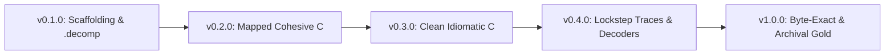

# Roadmap

Current baseline: **v0.2.0 (Beta — Cohesive Mapped C & Multi-Tier Snapshots)** | Active target: **v0.2.0** | See [CHANGELOG.md](CHANGELOG.md) for release notes.

## Vision

- **v0.4.0 (Verified Behavioral Parity & Format Specs):** Modular, warning-free, idiomatic C11 covering all `499` functions alongside frame-by-frame RAM/PPU/APU execution lockstep and complete clean-room decoders for Bank `1..4` and sound tables.
- **v1.0.0 (Byte-Exact & Archival Gold Reference):** Full clean-room BYO-ROM round-trip matching the verified `131,088`-byte `NES-ME-USA` image (`CRC32=25BA3D04`), zero unresolved format fields, live static documentation site, and `reCart`-ready `.decomp` bundle.

## Active Milestone: v0.2.0 — Mapped Cohesive C Modules & Multi-Tier Snapshots

- [x] Author clean-room partition and symbol-override schemas (`d3_module_map.json`, `d3_symbol_overrides.json`) grouping all `499` functions across `26` domain C modules (`10` core fixed-bank modules + `16` switchable-bank overlay modules) and resolving `1` local label, `20` synthetic/bank-scoped symbol entries (`18` deduplicated externs), `44` raw function overrides, `8` declarative bank/signature adapters, and `9` sub-entry prototypes.
- [x] Build `coalesce_d4_modules.py` and `materialize_decomp_tiers.py` (`<= 250` code lines each, reusing shared CLI containment) to replace all `68` line-split fragments with the `26` cohesive domain modules, rewrite all `299` raw symbol aliases and `44` raw calls (`0` remaining raw tokens), synthesize the `8` adapters into `core_unrom_and_math.c`, and preserve raw, sliced, and mapped local snapshot tiers.
- [x] Upgrade `d4_harness/` and `build_and_verify_d4.py` to mapped `g_*` scalar and array globals (`g_fixed_tbl_ff99`, `g_vram_transfer_queue`, `g_snd_pause_backup`), verifying `26/26` freestanding C11 module compilations (`0` errors, `0` warnings) and `10/10` host parity assertions alongside `8/8` ROM bank `1:1` byte-exact 6502 assembly (`CRC32=25BA3D04`).
- [x] Expand the offline `unittest` suite (`18/18` passing, adding `test_tiers_and_coalesce.py`) and `verify_track_d5.py` (`14/14` full checks, `8/8` offline synthetic), validate `v0.2.0` `IronFrame-OuterFortress-Cart-01.decomp` strictly against `reCart` (`0.1.x`) clean-room rules, synchronize documentation and release bundles, and cut clean source archives.

## Upcoming Milestones

- **v0.3.0 — Clean Idiomatic C & Subsystem Parity:** Refactor every function file-by-file into human-authored C11 with zero decompiler idioms, remove compiler/linter suppressions, compile cleanly under `-Wall -Wextra -Wno-unused-parameter`, and ship zero-body rewrite shards.
- **v0.4.0 — Frame-by-Frame Execution Lockstep & Bank Decoders:** Build a clean-room NES bus runtime to verify multi-scene WRAM/OAM/PPU/APU traces against reference execution oracles (with hardware stack masked transparently), and ship flat decoders and specification chapters for Bank `1..4` and sound tables.
- **v1.0.0 — Byte-Exact & Archival Reference Gold:** Certify clean-room end-to-end ROM verification from a fresh clone with user-supplied media, finalize zero-gap format coverage (`0` unresolved fields) and technical manuals, and publish the non-prerelease Gold milestone.

## Completed Milestones

- [x] **v0.2.0 Mapped Cohesive C Modules & Multi-Tier Snapshots (`2026-11-20`):** Coalesced all `499 / 499` functions from `68` line-split fragments into `26` cohesive domain C modules (`10` core + `16` overlay modules), resolved all `299` raw symbol aliases and `44` raw cross-bank calls (`0` remaining raw tokens, `8` synthesized adapters), preserved raw/sliced/mapped local snapshot tiers, compiled `26/26` C11 modules (`0` errors/warnings, `10/10` mapped host parity), matched `8/8` ROM banks `1:1` (`CRC32=25BA3D04`), passed `18/18` offline `unittest` cases and `14/14` `verify_track_d5.py` checks, and shipped the validated `v0.2.0` `.decomp` bundle. ([Notes](CHANGELOG.md#020---2026-11-20))
- [x] **v0.1.0 Clean-Room Tooling & Baseline (`2026-11-20`):** Verified `1:1` 6502 assembly reassembly across `8 / 8` PRG banks (`131,088` bytes, `CRC32=25BA3D04`), indexed `499 / 499` functions and `2,324 / 2,324` globals across `22` structs and `22` enums, delivered BYO-ROM unpacking and `reCart` (`0.1.x`) validated `IronFrame-OuterFortress-Cart-01.decomp`, passed `14/14` offline `unittest` cases and `12/12` `verify_track_d5.py` checks, and shipped the `v0.1.0` pre-release and human-first GitHub Pages site. ([Notes](CHANGELOG.md#010---2026-11-20))

## Icebox

- **Regional Revisions & Original Computer Contrast:** Comparative offset, text, and layout notes contrasting Japanese cartridge variants and original home-computer hardware layouts.
- **Downstream Recompilation Reference:** Passive read-only schema and `.decomp` consumption by `IronFrame-OuterFortress-Cart-01-Recomp` targeting `reCart` (tracked independently downstream).
