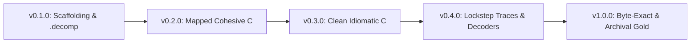

# Roadmap

Current baseline: **v0.1.0 (Beta — `D2/S4/R0` Baseline & Clean-Room `.decomp`)** | Active target: **v0.1.0** | See [CHANGELOG.md](CHANGELOG.md) for release notes.

## Vision

- **v0.4.0 (Verified Behavioral Parity & Format Specs):** Modular, warning-free, idiomatic C11 covering all `499` functions alongside frame-by-frame RAM/PPU/APU execution lockstep and complete clean-room decoders for Bank `1..4` and sound tables.
- **v1.0.0 (Byte-Exact & Archival Gold Reference):** Full clean-room BYO-ROM round-trip matching the verified `131,088`-byte `NES-ME-USA` image (`CRC32=25BA3D04`), zero unresolved format fields, live static documentation site, and `reCart`-ready `.decomp` bundle.

## Active Milestone: v0.1.0 — Clean-Room Scaffolding, Portable Package & Public Storefront

- [x] Establish coded repository identity (`IronFrame-OuterFortress-Cart-01-Decomp`), community health templates, security and contribution guides, offline CI checks (`.github/workflows/ci.yml`), clean-room emblems (`Dev/assets/`), and human-first GitHub Pages static site workflow (`.github/workflows/pages.yml`).
- [x] Scrub workstation paths, personal archive paths, and uncoded trademarks across root docs, technical manuals, headers, catalogs, stage notes, and IDE workspace configuration.
- [x] Purge all four embedded `BANK_06` C function bodies and `READABLE_FIXES` from `Dev/scripts/gen_d4_globals_and_lifts.py` and centralize standalone CLI path overrides (`--data-dir`, `--out-dir`, `--log-dir`, `--offline-synthetic`) via `Dev/scripts/nes_cli_common.py`.
- [x] Author self-contained `nes_unrom_unpack.py` + `nes_6502_cfg.py`, upgrade `standalone_integrity.json` to v2 (`1` BYO-ROM checksum + `17` deterministic `extracted/` entries), and export `reCart` (`0.1.x`) validated `IronFrame-OuterFortress-Cart-01.decomp` via `export_decomp_bundle.py` and `package_release.py`.
- [x] Split `d4_harness/` into four modular C/H files (`<= 200` lines each), fix UNROM `$8000` bank-swap and sound pause-mute tests (`10/10`), verify `14/14` offline `unittest` tests and `12/12` `verify_track_d5.py` checks (`D2/S4/R0`), and upgrade all JSON reports to schema v2.
- [x] Rebuild clean local source archive snapshots, perform human-reviewed clean Git history reset, publish the `v0.1.0` pre-release, and activate live GitHub Pages.

## Upcoming Milestones

- **v0.2.0 — Mapped Cohesive C:** Coalesce all `499` functions from `68` legacy line-split fragments into logical domain C modules, resolve remaining raw global aliases and missing declarations, and materialize local multi-tier snapshot trees.
- **v0.3.0 — Clean Idiomatic C & Subsystem Parity:** Refactor every function file-by-file into human-authored C11 with zero decompiler tells, remove compiler/linter suppressions, compile cleanly under `-Wall -Wextra -Wno-unused-parameter`, and ship zero-body rewrite shards.
- **v0.4.0 — Frame-by-Frame Execution Lockstep & Bank Decoders:** Build a clean-room NES bus runtime to verify multi-scene WRAM/OAM/PPU/APU traces against reference execution oracles (with hardware stack masked transparently), and ship flat decoders and specification chapters for Bank `1..4` and sound tables.
- **v1.0.0 — Byte-Exact & Archival Reference Gold:** Certify clean-room end-to-end ROM verification from a fresh clone with user-supplied media, finalize zero-gap format coverage (`0` unresolved fields) and technical manuals, and publish the non-prerelease Gold milestone.

## Completed Milestones

- [x] **v0.1.0 Clean-Room Tooling & Baseline (`2026-11-20`):** Verified `1:1` 6502 assembly reassembly across `8 / 8` PRG banks (`131,088` bytes, `CRC32=25BA3D04`), indexed `499 / 499` functions and `2,324 / 2,324` globals across `22` structs and `22` enums (`D2/S4/R0`), delivered BYO-ROM unpacking and `reCart` (`0.1.x`) validated `IronFrame-OuterFortress-Cart-01.decomp`, passed `14/14` offline `unittest` cases and `12/12` `verify_track_d5.py` checks, and shipped the `v0.1.0` pre-release and human-first GitHub Pages site. ([Notes](CHANGELOG.md#010---2026-11-20))

## Icebox

- **Regional Revisions & Original Computer Contrast:** Comparative offset, text, and layout notes contrasting Japanese cartridge variants and original home-computer hardware layouts.
- **Downstream Recompilation Reference:** Passive read-only schema and `.decomp` consumption by `IronFrame-OuterFortress-Cart-01-Recomp` targeting `reCart` (tracked independently downstream).
